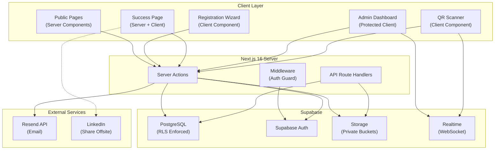
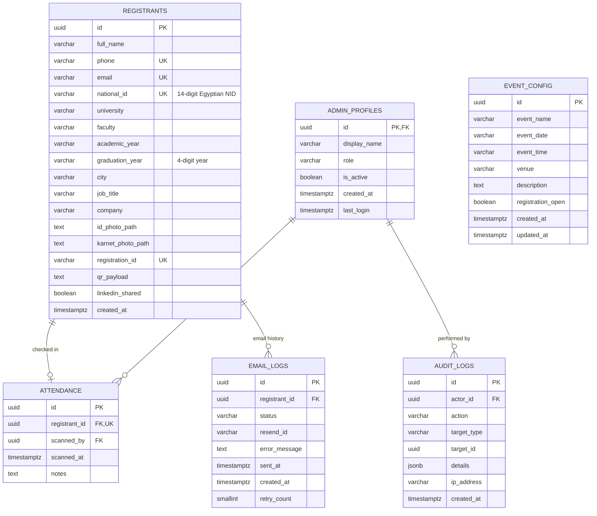
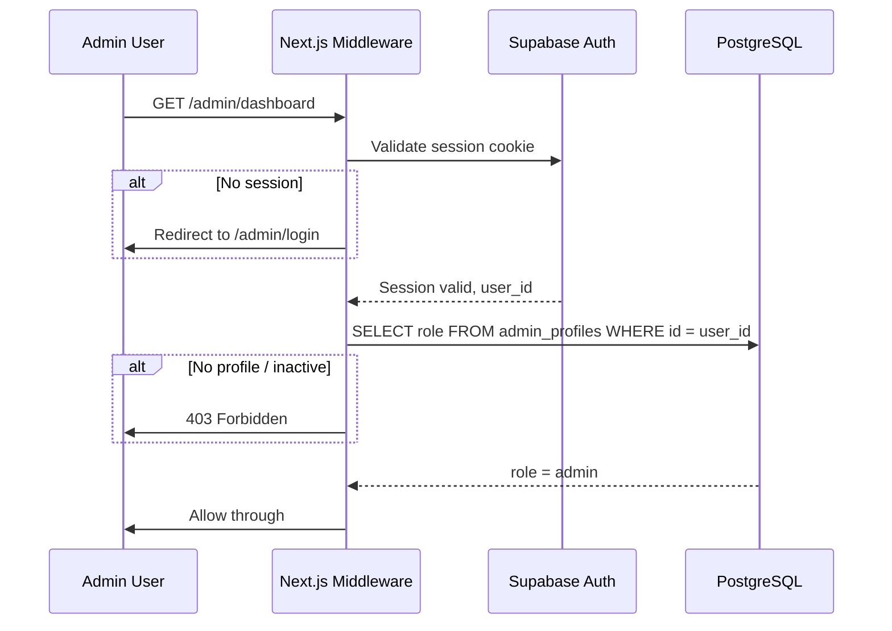
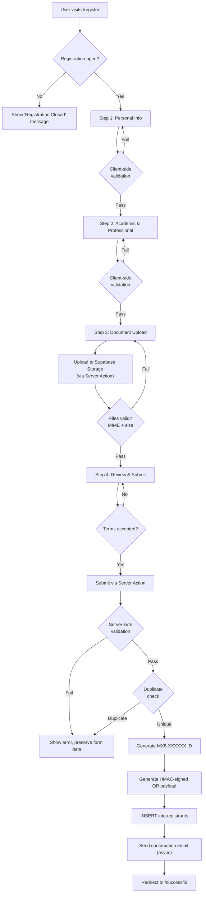
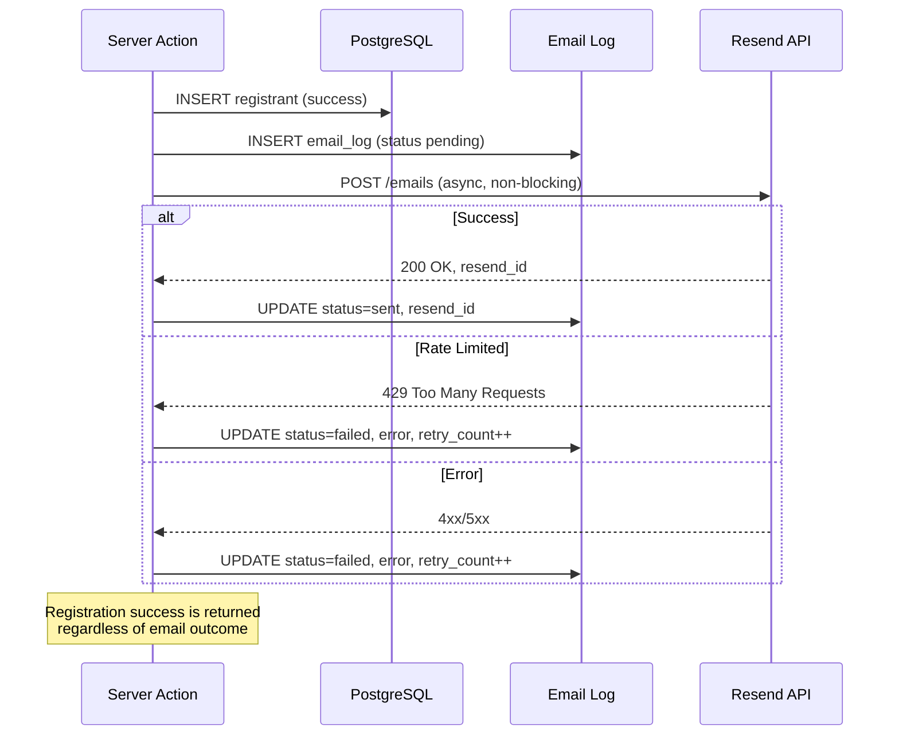
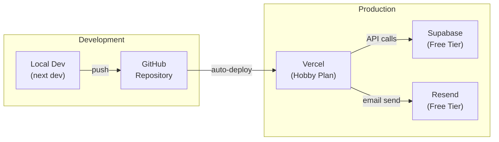

# ESME METRIX — Master Architecture & Implementation Plan

**Version:** 1.0  
**Date:** 2026-11-23  
**Status:** AWAITING APPROVAL — No implementation until approved.  
**Organization:** ESME Cairo University Student Chapter  
**Classification:** Internal Engineering Document

---

## Table of Contents

1. [Executive Summary](#1-executive-summary)
2. [Repository Assessment](#2-repository-assessment)
3. [System Architecture](#3-system-architecture)
4. [Technology Stack & Dependency Decisions](#4-technology-stack--dependency-decisions)
5. [Database Schema & Relationships](#5-database-schema--relationships)
6. [Authentication & Authorization Strategy](#6-authentication--authorization-strategy)
7. [Security Architecture](#7-security-architecture)
8. [Registration Workflow](#8-registration-workflow)
9. [QR Generation & Verification Architecture](#9-qr-generation--verification-architecture)
10. [Email Delivery Architecture](#10-email-delivery-architecture)
11. [LinkedIn Sharing Architecture](#11-linkedin-sharing-architecture)
12. [Admin Dashboard Structure](#12-admin-dashboard-structure)
13. [QR Scanner & Attendance Architecture](#13-qr-scanner--attendance-architecture)
14. [UI/UX Design System](#14-uiux-design-system)
15. [Animation & Motion Design Strategy](#15-animation--motion-design-strategy)
16. [Responsive Design Strategy](#16-responsive-design-strategy)
17. [Performance Optimization Strategy](#17-performance-optimization-strategy)
18. [Testing Strategy](#18-testing-strategy)
19. [Deployment Architecture](#19-deployment-architecture)
20. [Development Roadmap & Milestones](#20-development-roadmap--milestones)
21. [Technical Limitations & Risks](#21-technical-limitations--risks)
22. [Implementation Complexity Estimates](#22-implementation-complexity-estimates)
23. [Acceptance Criteria per Module](#23-acceptance-criteria-per-module)

---

## 1. Executive Summary

ESME METRIX is a complete event registration and attendance management platform for ESME Cairo University Student Chapter. It manages the full attendee lifecycle:

**Registration → Verification → Digital Identity → Email Confirmation → Social Sharing → Event Check-in → Attendance Analytics**

### Core Capabilities

| Capability | Description |
|---|---|
| **Multi-Step Registration** | 4-step wizard: Personal → Academic → Document Upload → Review |
| **Digital QR Identity** | HMAC-SHA256 signed, server-verified QR codes per registrant |
| **Email Confirmation** | Branded HTML email with embedded QR via Resend API |
| **Social Sharing** | Canvas-generated attendance card + LinkedIn share-offsite |
| **Admin Dashboard** | Real-time analytics, registrant management, search, export |
| **QR Scanner** | Browser-based camera scanner with live attendance recording |
| **Attendance System** | Atomic, duplicate-proof check-in with realtime sync |

### Key Architectural Decisions

1. **Next.js 16** with App Router (latest stable) — NOT Next.js 14 as in the original spec.
2. **`qr-scanner`** npm package replaces `html5-qrcode` (unmaintained since 2023). Falls back to `BarcodeDetector` API natively where supported.
3. **HMAC-SHA256** server-side QR signing replaces the spec's client-visible SHA256 hash.
4. **QR data URL generation on-demand** — no Base64 storage in PostgreSQL.
5. **Private storage buckets** with signed URLs for all sensitive documents.
6. **LinkedIn `share-offsite`** URL-only flow — no programmatic posting (LinkedIn API limitation).
7. **`linkedin_shared`** marked via explicit user confirmation button, not automatic detection.

---

## 2. Repository Assessment

### Current State

The working directory `d:\ESME Metrix Registeration` is **empty** — this is a greenfield project.

### Existing ESME Platform Reference

A related ESME platform exists at `D:\esme-cu-platform` (Vite + React SPA, NOT Next.js). Key learnings from that codebase:

| Aspect | Existing Platform | ESME METRIX Decision |
|---|---|---|
| **Framework** | Vite + React 19 SPA | Next.js 16 App Router (SSR/RSC) |
| **Routing** | Client-side SPA routing | File-system routing with server components |
| **Styling** | Tailwind CSS v4 + custom tokens | Tailwind CSS v4 + shadcn/ui + custom tokens |
| **Animation** | GSAP + Lenis + Motion | Motion (Framer Motion) only — simpler, sufficient |
| **Icons** | HugeIcons + Lucide | Lucide only (consistent, smaller bundle) |
| **Charts** | Recharts | Recharts (proven in org) |
| **Excel** | ExcelJS | ExcelJS (proven in org) |
| **Supabase** | @supabase/supabase-js v2 | @supabase/supabase-js v2 (latest) |
| **3D** | Three.js | Not used (unnecessary for this product) |

**We will NOT copy or fork the existing platform.** ESME METRIX is architecturally distinct (Next.js App Router vs. Vite SPA). However, we will reference the existing platform's color palette conventions and Supabase migration patterns.

---

## 3. System Architecture

### High-Level Architecture



### Module Decomposition

```
src/
├── app/                          # Next.js App Router
│   ├── (public)/                 # Public route group
│   │   ├── page.tsx              # Landing / event page
│   │   ├── register/page.tsx     # Registration wizard
│   │   └── success/[id]/page.tsx # Success + QR + LinkedIn
│   ├── (admin)/                  # Protected admin route group
│   │   ├── admin/page.tsx        # Redirect → dashboard
│   │   ├── admin/login/page.tsx  # Admin login
│   │   ├── admin/dashboard/     
│   │   ├── admin/registrants/   
│   │   ├── admin/attendance/    
│   │   ├── admin/scanner/       
│   │   └── admin/search/        
│   ├── api/                      # API route handlers
│   │   ├── register/route.ts     # Registration endpoint
│   │   ├── verify-qr/route.ts    # QR verification
│   │   ├── attendance/route.ts   # Check-in endpoint
│   │   └── email/resend/route.ts # Email retry
│   ├── layout.tsx                # Root layout
│   ├── not-found.tsx            
│   └── error.tsx                
├── actions/                      # Server Actions
│   ├── register.ts              
│   ├── verify-qr.ts            
│   ├── attendance.ts            
│   ├── admin.ts                 
│   └── email.ts                 
├── components/                   
│   ├── ui/                       # shadcn/ui components
│   ├── registration/             # Registration wizard components
│   ├── admin/                    # Dashboard components
│   ├── scanner/                  # QR scanner components
│   ├── email/                    # Email template components
│   └── shared/                   # Shared layout components
├── lib/                          
│   ├── supabase/                 
│   │   ├── client.ts             # Browser Supabase client
│   │   ├── server.ts             # Server Supabase client
│   │   └── admin.ts              # Service-role client (server only)
│   ├── qr/                      
│   │   ├── generate.ts           # QR generation (server)
│   │   ├── sign.ts               # HMAC signing (server)
│   │   └── verify.ts             # Signature verification (server)
│   ├── email/                   
│   │   └── send.ts               # Resend integration
│   ├── validations/             
│   │   ├── registration.ts       # Zod schemas
│   │   └── admin.ts             
│   └── utils/                   
│       ├── id-generator.ts       # MX8-XXXXXX generator
│       ├── file-validation.ts    # MIME/size checks
│       └── constants.ts         
├── hooks/                        # Client-side React hooks
├── types/                        # Shared TypeScript types
├── styles/                       # Design tokens, globals
└── config/                       # Environment, constants
```

### Architectural Principles

1. **Server-First**: Use React Server Components (RSC) by default. Use `'use client'` only for interactive components (forms, scanner, charts).
2. **Server Actions for Mutations**: All data mutations go through Server Actions, never direct client-to-Supabase writes.
3. **API Routes for External Calls**: QR verification and email retry endpoints exposed as API routes for programmatic access.
4. **Middleware for Auth Guards**: Next.js middleware intercepts `/admin/*` routes and enforces authentication before the page loads.
5. **Supabase RLS as Defense-in-Depth**: Even if middleware is bypassed, RLS policies prevent unauthorized data access.

---

## 4. Technology Stack & Dependency Decisions

### Core Dependencies

| Package | Version | Purpose | Rationale |
|---|---|---|---|
| `next` | `^16.4` | Framework | Latest stable; App Router is default |
| `react` / `react-dom` | `^19.2` | UI library | Required by Next.js 16 |
| `typescript` | `~6.0` | Type safety | Strict mode enabled |
| `tailwindcss` | `^4.3` | Styling | Utility-first; consistent with existing ESME platform |
| `@supabase/supabase-js` | `^2.118` | Backend client | Mature, stable v2 API |
| `@supabase/ssr` | `^0.6` | Server-side Supabase | Cookie-based auth for Next.js App Router |

### UI Components

| Package | Version | Purpose | Rationale |
|---|---|---|---|
| `shadcn/ui` (via CLI) | latest | Component primitives | Composable, unstyled, accessible |
| `lucide-react` | `^1.56` | Icons | Consistent, tree-shakeable |
| `recharts` | `^3.10` | Charts | Proven in existing ESME platform |
| `motion` | `^14.3` | Animation | The modern name for Framer Motion; React 19 compatible |
| `clsx` | `^2.1` | Class merging | Minimal utility |
| `tailwind-merge` | `^3.7` | Tailwind class merging | Prevents class conflicts in shadcn/ui |

### Form & Validation

| Package | Version | Purpose | Rationale |
|---|---|---|---|
| `react-hook-form` | `^7.55` | Form state | Performance, uncontrolled inputs |
| `zod` | `^3.24` | Schema validation | Type-safe; shared between client and server |
| `@hookform/resolvers` | `^5.0` | RHF + Zod bridge | Integrates Zod with React Hook Form |

### QR System

| Package | Version | Purpose | Rationale |
|---|---|---|---|
| `qrcode` | `^1.5` | QR generation | Server-side PNG/data-URL generation |
| `@types/qrcode` | `^1.5` | Types | TypeScript support |
| `qr-scanner` | `^1.4` | QR scanning | **Replaces `html5-qrcode`** — actively maintained, uses native `BarcodeDetector` API when available, runs decoding in WebWorker |

> **IMPORTANT — `html5-qrcode` is NOT recommended.** It has not been updated since 2023 and is in maintenance-seeking mode. `qr-scanner` is superior: it uses the native `BarcodeDetector` API (Chrome/Edge/Android), falls back to a WebWorker-based decoder, and keeps the UI thread responsive.

### Email & Utilities

| Package | Version | Purpose | Rationale |
|---|---|---|---|
| `resend` | `^4.5` | Email API client | Official SDK |
| `exceljs` | `^4.4` | Excel export | Proven in existing ESME platform |
| `html-to-image` | `^1.11` | Card PNG export | Canvas-based, more reliable than raw `html2canvas` |

### Dev Dependencies

| Package | Purpose |
|---|---|
| `@testing-library/react` | Component testing |
| `vitest` | Unit/integration tests |
| `playwright` | E2E testing |
| `oxlint` | Fast linting |

### Packages Explicitly NOT Used

| Package | Reason |
|---|---|
| `html5-qrcode` | Unmaintained; replaced by `qr-scanner` |
| `three.js` | No 3D requirements in METRIX |
| `gsap` | Motion (Framer Motion) is sufficient; reduces bundle |
| `lenis` | Smooth scroll unnecessary for a registration platform |
| `canvas-confetti` | Not in requirements |
| `@hugeicons/*` | Lucide covers all icon needs |

---

## 5. Database Schema & Relationships

### Entity-Relationship Diagram



### Table Definitions

#### `registrants`

```sql
CREATE TABLE public.registrants (
  id              UUID DEFAULT gen_random_uuid() PRIMARY KEY,
  full_name       VARCHAR(255) NOT NULL,
  phone           VARCHAR(20)  NOT NULL,
  email           VARCHAR(255) NOT NULL,
  national_id     VARCHAR(20),               -- 14-digit Egyptian National ID (sensitive)
  university      VARCHAR(255) NOT NULL,
  faculty         VARCHAR(255) NOT NULL,
  academic_year   VARCHAR(50)  NOT NULL,
  graduation_year VARCHAR(10),               -- 4-digit year, e.g. 2026
  city            VARCHAR(100) NOT NULL,
  job_title       VARCHAR(255) NOT NULL DEFAULT 'Student',
  company         VARCHAR(255),              -- nullable for students
  id_photo_path   TEXT NOT NULL,              -- storage path, NOT a public URL
  karnet_photo_path TEXT NOT NULL,            -- storage path, NOT a public URL
  registration_id VARCHAR(20) NOT NULL,
  qr_payload      TEXT NOT NULL,              -- signed payload (compact), NOT base64 image
  linkedin_shared BOOLEAN DEFAULT FALSE,
  created_at      TIMESTAMPTZ DEFAULT NOW(),

  CONSTRAINT uq_phone UNIQUE (phone),
  CONSTRAINT uq_email UNIQUE (email),
  CONSTRAINT uq_registration_id UNIQUE (registration_id),
  CONSTRAINT registrants_national_id_format_chk
    CHECK (national_id IS NULL OR national_id ~ '^[23][0-9]{13}$'),
  CONSTRAINT registrants_graduation_year_format_chk
    CHECK (graduation_year IS NULL OR graduation_year ~ '^(19|20)[0-9]{2}$')
);

-- One registration per National ID (NULL allowed for rows created before the field existed)
CREATE UNIQUE INDEX uq_registrants_national_id ON public.registrants (national_id)
  WHERE national_id IS NOT NULL;
CREATE INDEX idx_registrants_graduation_year ON public.registrants (graduation_year);

CREATE INDEX idx_registrants_university ON public.registrants (university);
CREATE INDEX idx_registrants_city ON public.registrants (city);
CREATE INDEX idx_registrants_academic_year ON public.registrants (academic_year);
CREATE INDEX idx_registrants_created_at ON public.registrants (created_at DESC);
CREATE INDEX idx_registrants_full_name_trgm ON public.registrants 
  USING gin (full_name gin_trgm_ops);
```

> **NOTE — `qr_payload`** stores the HMAC-signed verification string (~200 bytes), NOT a Base64-encoded QR image (~20KB+). The QR image is generated on-demand from this payload using the `qrcode` library whenever it needs to be displayed or emailed. This saves ~95% of the storage that the original spec's approach would consume.

> **NOTE — `id_photo_path` and `karnet_photo_path`** store Supabase Storage paths (e.g., `registrations/{id}/id_photo.jpg`), NOT public URLs. Signed URLs are generated at view-time with short expiration. This prevents permanent public access to sensitive identity documents.

#### `attendance`

```sql
CREATE TABLE public.attendance (
  id              UUID DEFAULT gen_random_uuid() PRIMARY KEY,
  registrant_id   UUID NOT NULL REFERENCES public.registrants(id) ON DELETE CASCADE,
  scanned_by      UUID NOT NULL REFERENCES auth.users(id),
  scanned_at      TIMESTAMPTZ DEFAULT NOW(),
  notes           TEXT,

  CONSTRAINT uq_attendance_registrant UNIQUE (registrant_id)
);

CREATE INDEX idx_attendance_scanned_at ON public.attendance (scanned_at DESC);
```

> **IMPORTANT — The `UNIQUE` constraint on `registrant_id`** ensures exactly one check-in per attendee at the database level. Combined with an `INSERT ... ON CONFLICT DO NOTHING` pattern, this provides atomic, race-condition-proof duplicate scan prevention even with multiple concurrent scanners.

#### `admin_profiles`

```sql
CREATE TABLE public.admin_profiles (
  id            UUID PRIMARY KEY REFERENCES auth.users(id) ON DELETE CASCADE,
  display_name  VARCHAR(255) NOT NULL,
  role          VARCHAR(50)  NOT NULL DEFAULT 'scanner'
                CHECK (role IN ('super_admin', 'admin', 'scanner')),
  is_active     BOOLEAN DEFAULT TRUE,
  created_at    TIMESTAMPTZ DEFAULT NOW(),
  last_login    TIMESTAMPTZ
);
```

#### `audit_logs`

```sql
CREATE TABLE public.audit_logs (
  id          UUID DEFAULT gen_random_uuid() PRIMARY KEY,
  actor_id    UUID REFERENCES auth.users(id),
  action      VARCHAR(100) NOT NULL,
  target_type VARCHAR(50)  NOT NULL,
  target_id   UUID,
  details     JSONB DEFAULT '{}',
  ip_address  VARCHAR(45),
  created_at  TIMESTAMPTZ DEFAULT NOW()
);

CREATE INDEX idx_audit_logs_actor ON public.audit_logs (actor_id);
CREATE INDEX idx_audit_logs_created_at ON public.audit_logs (created_at DESC);
```

#### `email_logs`

```sql
CREATE TABLE public.email_logs (
  id              UUID DEFAULT gen_random_uuid() PRIMARY KEY,
  registrant_id   UUID NOT NULL REFERENCES public.registrants(id) ON DELETE CASCADE,
  status          VARCHAR(20) NOT NULL DEFAULT 'pending'
                  CHECK (status IN ('pending', 'sent', 'delivered', 'failed', 'bounced')),
  resend_id       VARCHAR(255),
  error_message   TEXT,
  sent_at         TIMESTAMPTZ,
  created_at      TIMESTAMPTZ DEFAULT NOW(),
  retry_count     SMALLINT DEFAULT 0
);

CREATE INDEX idx_email_logs_registrant ON public.email_logs (registrant_id);
CREATE INDEX idx_email_logs_status ON public.email_logs (status);
```

#### `event_config`

```sql
CREATE TABLE public.event_config (
  id                UUID DEFAULT gen_random_uuid() PRIMARY KEY,
  event_name        VARCHAR(255) NOT NULL DEFAULT 'ESME METRIX 2026',
  event_date        VARCHAR(50)  NOT NULL,
  event_time        VARCHAR(50)  NOT NULL,
  venue             VARCHAR(500) NOT NULL,
  description       TEXT,
  registration_open BOOLEAN DEFAULT TRUE,
  created_at        TIMESTAMPTZ DEFAULT NOW(),
  updated_at        TIMESTAMPTZ DEFAULT NOW()
);
-- Singleton pattern: only one row allowed
```

### Storage Buckets

| Bucket | Access | Purpose |
|---|---|---|
| `registrations` | **Private** | National ID and Karnet photos |

File path convention: `registrations/{registrant_uuid}/id_photo.{ext}` and `registrations/{registrant_uuid}/karnet_photo.{ext}`

Signed URL expiration: **5 minutes** (configurable).

---

## 6. Authentication & Authorization Strategy

### Authentication Flow



### Role Model

| Role | Capabilities |
|---|---|
| `super_admin` | Everything. Manage admins, event config, view all data, scan, export, audit. |
| `admin` | View registrants, manage attendance, scan, search, export. Cannot manage other admins or event config. |
| `scanner` | QR scanner only. Can record attendance. Cannot view registrant lists or export data. |

### Implementation

1. **Supabase Auth** handles email/password authentication for admins.
2. **Next.js Middleware** (`middleware.ts`) intercepts all `/admin/*` routes:
   - Reads the Supabase session from cookies.
   - Verifies the session with Supabase Auth.
   - Checks `admin_profiles` for an active profile with an appropriate role.
   - Redirects unauthenticated users to `/admin/login`.
3. **Server Actions** re-verify authorization before every mutation.
4. **RLS Policies** enforce access at the database level (defense-in-depth).

### Admin Creation

Admins are created **only** through one of:
1. Direct SQL insert by the `super_admin` via Supabase dashboard.
2. A protected Server Action callable only by `super_admin`.

**There is no self-registration for admins.** No public signup endpoint exists.

---

## 7. Security Architecture

### Threat Model & Mitigations

| Threat | Mitigation |
|---|---|
| **Unauthorized registrant data access** | Private storage buckets; signed URLs with 5-min expiry; RLS policies |
| **Forged QR codes** | HMAC-SHA256 signing with server-only secret; server-side verification |
| **Duplicate registrations** | DB-level UNIQUE constraints on phone + email; server-side validation |
| **Double attendance** | DB-level UNIQUE constraint on `attendance.registrant_id`; `INSERT ... ON CONFLICT DO NOTHING` |
| **Race condition (concurrent scans)** | Atomic `INSERT ... ON CONFLICT` — PostgreSQL handles serialization |
| **Admin privilege escalation** | No client-side role mutation; RLS prevents self-promotion; `admin_profiles` requires `super_admin` to modify |
| **XSS via file upload** | MIME type validation (magic bytes, not extension); Content-Security-Policy headers |
| **Oversized uploads** | 5MB limit enforced server-side AND via Supabase Storage policies |
| **Sensitive data in client bundle** | Service-role key only in `process.env` (no `NEXT_PUBLIC_` prefix); QR signing secret server-only |
| **Email enumeration** | Duplicate-check responses are generic ("Registration failed") — not "Email already exists" |
| **Session fixation/hijack** | Supabase Auth uses `httpOnly`, `secure`, `sameSite=lax` cookies |

### Row Level Security Policies

```sql
-- registrants: public can INSERT (for registration), only admins can SELECT
ALTER TABLE public.registrants ENABLE ROW LEVEL SECURITY;

CREATE POLICY "allow_public_insert" ON public.registrants
  FOR INSERT WITH CHECK (true);  -- validated by server action

CREATE POLICY "allow_admin_select" ON public.registrants
  FOR SELECT USING (
    auth.uid() IN (SELECT id FROM public.admin_profiles WHERE is_active = true)
  );

CREATE POLICY "allow_admin_update" ON public.registrants
  FOR UPDATE USING (
    auth.uid() IN (SELECT id FROM public.admin_profiles WHERE is_active = true)
  );

-- attendance: only admins can INSERT/SELECT
ALTER TABLE public.attendance ENABLE ROW LEVEL SECURITY;

CREATE POLICY "allow_admin_insert" ON public.attendance
  FOR INSERT WITH CHECK (
    auth.uid() IN (SELECT id FROM public.admin_profiles WHERE is_active = true)
  );

CREATE POLICY "allow_admin_select" ON public.attendance
  FOR SELECT USING (
    auth.uid() IN (SELECT id FROM public.admin_profiles WHERE is_active = true)
  );

-- admin_profiles: only self or super_admin
ALTER TABLE public.admin_profiles ENABLE ROW LEVEL SECURITY;

CREATE POLICY "allow_self_select" ON public.admin_profiles
  FOR SELECT USING (auth.uid() = id);

CREATE POLICY "allow_super_admin_all" ON public.admin_profiles
  FOR ALL USING (
    auth.uid() IN (SELECT id FROM public.admin_profiles WHERE role = 'super_admin')
  );

-- audit_logs: only super_admin can read; insert via service role
ALTER TABLE public.audit_logs ENABLE ROW LEVEL SECURITY;

CREATE POLICY "allow_super_admin_select" ON public.audit_logs
  FOR SELECT USING (
    auth.uid() IN (SELECT id FROM public.admin_profiles WHERE role = 'super_admin')
  );

-- email_logs: only admins can read
ALTER TABLE public.email_logs ENABLE ROW LEVEL SECURITY;

CREATE POLICY "allow_admin_select_emails" ON public.email_logs
  FOR SELECT USING (
    auth.uid() IN (SELECT id FROM public.admin_profiles WHERE is_active = true)
  );
```

### File Upload Security

1. **Client-side**: Accept only `image/jpeg` and `image/png`; max 5MB; show preview.
2. **Server Action**: Validate:
   - File size ≤ 5MB.
   - MIME type from magic bytes (first 4-8 bytes) matches JPEG/PNG.
   - File extension matches MIME type.
3. **Supabase Storage Policy**: Restrict `registrations` bucket to:
   - `INSERT` with max file size 5MB.
   - `SELECT` only for authenticated admin users.
   - `DELETE` only for `super_admin`.

### Environment Variables

| Variable | Scope | Description |
|---|---|---|
| `NEXT_PUBLIC_SUPABASE_URL` | Client + Server | Supabase project URL |
| `NEXT_PUBLIC_SUPABASE_ANON_KEY` | Client + Server | Publishable anon key |
| `SUPABASE_SERVICE_ROLE_KEY` | **Server only** | Privileged access — NEVER exposed to client |
| `QR_SIGNING_SECRET` | **Server only** | HMAC-SHA256 key for QR payload signing |
| `RESEND_API_KEY` | **Server only** | Resend email API key |
| `RESEND_FROM_EMAIL` | **Server only** | Verified sender address |

---

## 8. Registration Workflow

### Complete Flow



### Step Details

**Step 1 — Personal Information**

| Field | Type | Validation |
|---|---|---|
| Full Name | text | Required, 2-100 chars, trimmed |
| National ID | text | Required, trimmed, matches `/^[23][0-9]{13}$/` (14 digits). Unique per registrant. |
| Phone | tel | Required, matches `/^01[0125]\d{8}$/` |
| Email | email | Required, valid email format, lowercase |
| City | select | Required, from predefined list of Egyptian cities |

**Step 2 — Academic & Professional**

| Field | Type | Validation |
|---|---|---|
| University | select/text | Required |
| Faculty | text | Required |
| Academic Year | select | Required, from: 1st, 2nd, 3rd, 4th, 5th, Graduate, Alumni |
| Graduation Year | select | Required, 4 digits (`19xx` or `20xx`), range 1990–2035 |
| Job Title | text | Required, default "Student" |
| Company | text | Optional |

**Step 3 — Document Upload**

| Field | Type | Validation |
|---|---|---|
| National ID Photo | file | Required, JPEG/PNG, ≤5MB, magic byte verification |
| Student Karnet Photo | file | Required, JPEG/PNG, ≤5MB, magic byte verification |

**Step 4 — Review & Submit**

- Display all entered data in read-only format.
- Each section links back to its step for editing.
- Terms & conditions checkbox (required).
- Submit button with loading state and duplicate-click protection.

### Duplicate Prevention

1. **Client-side**: After Step 1, debounced server-side check for phone/email/National ID uniqueness (Server Action returning `{ available: boolean }`). Generic error message, no enumeration.
2. **Server-side**: `/api/register` first queries `registrants` for a matching phone, email **or** National ID and returns 409. The `INSERT` is the final guard: it fails on the UNIQUE constraints (`phone`, `email`, `uq_registrants_national_id`) with code `23505`, or on the format CHECKs (`registrants_national_id_format_chk`, `registrants_graduation_year_format_chk`) with code `23514`. Both are mapped to friendly messages.
3. **Submit button**: Disabled after first click; re-enabled on error.

### Form Data Persistence

- React Hook Form manages all form state in memory across steps.
- Form data is NOT persisted to `localStorage` (sensitive documents involved).
- If a user navigates away, data is lost (by design — prevents sensitive data leaks on shared devices).

---

## 9. QR Generation & Verification Architecture

### QR Payload Design

The QR code encodes a compact, signed verification token:

```
{base64url(payload)}.{signature}
```

Where `payload` is:
```json
{
  "rid": "MX8-A3F7K9",
  "uid": "550e8400-e29b-41d4-a716-446655440000",
  "evt": "METRIX_2026",
  "iat": 1732358400
}
```

And `signature` is:
```
HMAC-SHA256(base64url(payload), QR_SIGNING_SECRET)
```

### Registration ID Format

Pattern: `MX8-XXXXXX` where X is alphanumeric (uppercase + digits, excluding ambiguous characters: `0O1lI`).

Character set: `ABCDEFGHJKMNPQRSTUVWXYZ23456789` (30 characters).

This gives 30^6 = **729,000,000** possible IDs — more than sufficient.

Generation: Server-side, with collision check (re-generate if already exists, though probability is negligible).

### QR Generation Flow (Server-Side)

```typescript
// lib/qr/sign.ts — SERVER ONLY
import { createHmac } from 'crypto';

function signQRPayload(registrationId: string, registrantId: string): string {
  const payload = {
    rid: registrationId,
    uid: registrantId,
    evt: 'METRIX_2026',
    iat: Math.floor(Date.now() / 1000),
  };
  
  const payloadB64 = Buffer.from(JSON.stringify(payload)).toString('base64url');
  const signature = createHmac('sha256', process.env.QR_SIGNING_SECRET!)
    .update(payloadB64)
    .digest('base64url');
  
  return `${payloadB64}.${signature}`;
}
```

### QR Verification Flow (Server-Side)

```typescript
// lib/qr/verify.ts — SERVER ONLY
function verifyQRPayload(token: string): VerifyResult {
  const [payloadB64, signature] = token.split('.');
  
  // Recompute HMAC
  const expected = createHmac('sha256', process.env.QR_SIGNING_SECRET!)
    .update(payloadB64)
    .digest('base64url');
  
  if (!timingSafeEqual(Buffer.from(signature), Buffer.from(expected))) {
    return { valid: false, reason: 'invalid_signature' };
  }
  
  const payload = JSON.parse(Buffer.from(payloadB64, 'base64url').toString());
  return { valid: true, registrationId: payload.rid, registrantId: payload.uid };
}
```

### QR Image Generation

The QR PNG is generated **on demand** using the `qrcode` package, NOT stored in the database:

- **Success page**: Generated server-side, passed as data URL to client.
- **Email**: Generated server-side, embedded as inline base64 in the email HTML.
- **Admin view**: Generated on request via Server Action.

This avoids storing ~20KB+ of Base64 per registrant in PostgreSQL.

---

## 10. Email Delivery Architecture

### Resend Free Tier Constraints (Verified November 2026)

| Limit | Value | Impact |
|---|---|---|
| Daily emails | 100/day | Sufficient for <100 registrations/day |
| Monthly emails | 3,000/month | Sufficient for event scale |
| Sending domains | 3 | Need 1 verified domain |
| Rate limit | 10 req/sec | Well within our needs |
| Data retention | 30 days | Adequate for event lifecycle |

> **WARNING — If the event expects >100 registrations in a single day**, the free tier will block emails mid-day. Mitigation strategies:
> 1. Space registrations over multiple days (open registration early).
> 2. Queue emails and send in batches across UTC day boundaries.
> 3. Upgrade to Resend Pro (\$20/month) for the event month only.
> The registration MUST succeed even if email fails. Email is treated as a secondary operation.

### Email Template Design

```
┌────────────────────────────────────────┐
│  ┌──────────────────────────────────┐  │
│  │   ESME Logo    |  ESME METRIX   │  │
│  └──────────────────────────────────┘  │
│                                        │
│  Congratulations, {Full Name}!         │
│                                        │
│  You're officially registered for      │
│  ESME METRIX 2026!                     │
│                                        │
│  ┌──────────────────────────────────┐  │
│  │                                  │  │
│  │        [QR CODE IMAGE]           │  │
│  │                                  │  │
│  │     Registration ID: MX8-A3F7K9  │  │
│  └──────────────────────────────────┘  │
│                                        │
│  --- Your Details ---                  │
│  Name: {Full Name}                     │
│  University: {University}              │
│  Registration ID: {MX8-XXXXXX}         │
│                                        │
│  --- Event Details ---                 │
│  Date: {Event Date}                    │
│  Venue: {Venue}                        │
│  Time: {Event Time}                    │
│                                        │
│  --- Check-in Instructions ---         │
│  1. Open this email on your phone      │
│  2. Show the QR code at the entrance   │
│  3. Our team will scan and welcome you │
│                                        │
│  ┌──────────────────────────────────┐  │
│  │  Facebook | LinkedIn | Instagram │  │
│  │  (C) 2026 ESME CU Chapter       │  │
│  └──────────────────────────────────┘  │
└────────────────────────────────────────┘
```

### Email Sending Flow



### Email Retry Strategy

1. **Automatic**: Not implemented (no cron on Vercel free tier's 2-job limit — reserved for other needs).
2. **Manual**: Admin can trigger retry from the dashboard for failed emails.
3. **Idempotency**: The email log tracks `resend_id` — if an email was already sent successfully for a registrant, the retry action skips it.
4. **Max retries**: 3 attempts per registrant.

---

## 11. LinkedIn Sharing Architecture

### Limitations (Verified November 2026)

| Aspect | Reality |
|---|---|
| **API Endpoint** | `https://www.linkedin.com/sharing/share-offsite/?url={url}` |
| **Custom text** | NOT supported — LinkedIn stripped all legacy text parameters |
| **Pre-populated post** | NOT possible via share-offsite |
| **Image upload** | NOT possible — LinkedIn scrapes OG tags from the URL |
| **Post detection** | NOT detectable — no callback or webhook from share-offsite |

### Implementation Strategy

1. **Generate Personalized Card**: Client-side using `html-to-image` to capture a styled DOM element as PNG.
2. **Download Card**: Allow user to save the PNG.
3. **Copy Caption**: Provide a pre-written social caption with #ESMEMetrix hashtag for the user to paste.
4. **Open LinkedIn**: Link to `share-offsite` with the success page URL as the shared URL.
5. **OG Meta Tags**: The `/success/{id}` page includes rich OG tags (title, description, image) so LinkedIn's crawler renders an attractive preview.
6. **Mark as Shared**: After the user opens LinkedIn, show a "I shared on LinkedIn!" confirmation button. This sets `linkedin_shared = true`. **We do not and cannot automatically verify the post was published.**

### Attendance Card Design (HTML/CSS → PNG)

```
┌──────────────────────────────────────────┐
│                                          │
│  [ESME Logo]        "Attending Proudly"  │
│                                          │
│  ━━━━━━━━━━━━━━━━━━━━━━━━━━━━━━━━━━━━━   │
│                                          │
│        ESME METRIX 2026                  │
│                                          │
│        {Attendee Name}                   │
│        Registration ID: MX8-A3F7K9       │
│                                          │
│  Date: {Date}  |  Venue: {Venue}         │
│                                          │
│  #ESMEMetrix                             │
│                                          │
│  ------------ ESME CU Chapter ---------- │
└──────────────────────────────────────────┘

Background: Deep teal to emerald gradient
Typography: White, premium sans-serif
```

---

## 12. Admin Dashboard Structure

### Route Map

| Route | Page | Access Level |
|---|---|---|
| `/admin/login` | Login page | Public |
| `/admin` | Redirect to `/admin/dashboard` | All admins |
| `/admin/dashboard` | Overview statistics | `admin`, `super_admin` |
| `/admin/registrants` | Registrant table + detail view | `admin`, `super_admin` |
| `/admin/attendance` | Attendance log (realtime) | `admin`, `super_admin` |
| `/admin/scanner` | QR scanner | All admins (incl. `scanner`) |
| `/admin/search` | Quick search and verify | All admins |
| `/admin/settings` | Event config, admin mgmt, audit | `super_admin` only |

### Dashboard Layout

```
┌─────────────────────────────────────────────┐
│  ESME METRIX    [Scanner] [Search] [Avatar] │  Top nav (mobile: hamburger)
├─────────┬───────────────────────────────────┤
│         │                                   │
│ Dash-   │  ┌──────┐ ┌──────┐ ┌──────┐      │
│ board   │  │ 1247 │ │  891 │ │ 71.4%│      │  KPI cards with animated counters
│         │  │Total │ │Attend│ │  Rate│      │
│ Regis-  │  └──────┘ └──────┘ └──────┘      │
│ trants  │                                   │
│         │  ┌────────────────────────────┐   │
│ Attend- │  │  Registration Growth       │   │  Line chart
│ ance    │  │  chart area                │   │
│         │  │                            │   │
│ Scanner │  └────────────────────────────┘   │
│         │                                   │
│ Search  │  ┌─────────────┐ ┌────────────┐  │
│         │  │ University  │ │ Academic   │  │  Pie/bar charts
│ Settings│  │ Distribution│ │ Year Dist. │  │
│         │  └─────────────┘ └────────────┘  │
│         │                                   │
└─────────┴───────────────────────────────────┘
```

### Dashboard KPIs

| KPI | Source | Update |
|---|---|---|
| Total Registrants | `COUNT(*) FROM registrants` | Realtime |
| Total Attended | `COUNT(*) FROM attendance` | Realtime |
| Attendance Rate | Attended / Registered × 100 | Realtime |
| LinkedIn Shares | `COUNT(*) FROM registrants WHERE linkedin_shared` | On load |
| Registration Growth | `GROUP BY date_trunc('day', created_at)` | On load |
| University Distribution | `GROUP BY university ORDER BY count DESC` | On load |
| Academic Year Distribution | `GROUP BY academic_year` | On load |
| City Distribution | `GROUP BY city ORDER BY count DESC` | On load |
| Recent Registrations | Last 10, ordered by `created_at DESC` | Realtime |
| Recent Check-ins | Last 10, ordered by `scanned_at DESC` | Realtime |

### Registrant Table Features

- **Columns**: Name, Phone, Email, University, Reg. ID, Date, Status (Attended/Not), Actions.
- **Search**: Debounced (300ms) full-text search across name, phone, email, registration_id.
- **Filters**: University (multi-select), City (multi-select), Academic Year (multi-select), Date range.
- **Sort**: By any column, ascending/descending.
- **Pagination**: Server-side, 25 per page.
- **Detail View**: Side panel or modal showing full registrant info + document images (signed URLs).
- **Export**: Excel download via ExcelJS (filtered or full dataset).

### Document Viewing (Admin Only)

When an admin clicks to view a registrant's uploaded documents:
1. Server Action generates a **signed URL** for each document with 5-minute expiry.
2. The signed URL is returned to the client.
3. The image is displayed in a modal.
4. After 5 minutes, the URL expires. Admin must request again.

---

## 13. QR Scanner & Attendance Architecture

### Scanner Interface

```
┌──────────────────────────────────────┐
│  ESME METRIX Scanner    [Exit]       │
├──────────────────────────────────────┤
│                                      │
│  ┌────────────────────────────────┐  │
│  │                                │  │
│  │        CAMERA VIEWPORT         │  │
│  │                                │  │
│  │     ┌──────────────────┐       │  │
│  │     │   SCAN AREA      │       │  │
│  │     └──────────────────┘       │  │
│  │        [Moving scan line]      │  │
│  └────────────────────────────────┘  │
│                                      │
│  ┌────────────────────────────────┐  │
│  │  RESULT FEEDBACK AREA          │  │
│  │  (Green / Orange / Red)        │  │
│  └────────────────────────────────┘  │
│                                      │
│  [Camera Select]  [Manual Search]    │
│                                      │
│  --- Recent Scans ---                │
│  OK  Ahmed Mohamed — 13:04:22        │
│  !!  Sara Ali — Already checked in   │
│  OK  Omar Hassan — 13:03:15          │
└──────────────────────────────────────┘
```

### Scanner States & Feedback

| State | Color | Message | Duration |
|---|---|---|---|
| **SUCCESS** | Green (#10B981) | "Welcome, {Name}!" + reg info | 3 seconds |
| **ALREADY SCANNED** | Orange (#F59A16) | "Already checked in at {time}" | 3 seconds |
| **INVALID QR** | Red (#EF4444) | "QR Code Not Recognized" | 3 seconds |
| **NETWORK ERROR** | Gray (#6B7280) | "Connection error. Please retry." | Until dismissed |
| **SCANNING** | Teal (#0D9488) | Animated scan line | Continuous |

### Attendance Recording (Atomic)

```sql
-- Called from Server Action via service role client
INSERT INTO public.attendance (registrant_id, scanned_by)
VALUES ($1, $2)
ON CONFLICT (registrant_id) DO NOTHING
RETURNING id, scanned_at;

-- If RETURNING is empty → already scanned
-- Combined with a SELECT to get the existing attendance record if already scanned
```

This guarantees exactly-once attendance recording even with concurrent scanners.

### Realtime Synchronization

```typescript
// In admin dashboard and attendance page
const channel = supabase
  .channel('attendance-updates')
  .on('postgres_changes', {
    event: 'INSERT',
    schema: 'public',
    table: 'attendance',
  }, (payload) => {
    // Update attendance count, add to recent check-ins
    updateDashboard(payload.new);
  })
  .subscribe();
```

The `attendance` table must be added to the `supabase_realtime` publication:
```sql
ALTER PUBLICATION supabase_realtime ADD TABLE public.attendance;
```

### Manual Verification Fallback

If the QR scanner fails (camera issues, damaged QR):
1. Admin opens the **Search** page.
2. Searches by phone number, name, or registration ID.
3. Views the registrant's profile.
4. Clicks "Manual Check-in" button.
5. Server Action records attendance with a note: "Manual check-in by {admin_name}".

---

## 14. UI/UX Design System

### Color Tokens

```css
:root {
  /* Primary — Deep Teal / Emerald */
  --color-primary-50:  #F0FDFA;
  --color-primary-100: #CCFBF1;
  --color-primary-200: #99F6E4;
  --color-primary-300: #5EEAD4;
  --color-primary-400: #2DD4BF;
  --color-primary-500: #14B8A6;   /* Primary action */
  --color-primary-600: #0D9488;   /* Primary hover */
  --color-primary-700: #0F766E;   /* Primary dark */
  --color-primary-800: #115E59;
  --color-primary-900: #134E4A;   /* Hero backgrounds */
  --color-primary-950: #042F2E;   /* Deepest teal */

  /* Accent — Emerald Green */
  --color-accent-500: #10B981;
  --color-accent-600: #059669;

  /* Neutral — Sophisticated surfaces */
  --color-surface-0:   #FFFFFF;
  --color-surface-50:  #F8FAFC;
  --color-surface-100: #F1F5F9;
  --color-surface-200: #E2E8F0;
  --color-surface-800: #1E293B;
  --color-surface-900: #0F172A;   /* Admin sidebar */
  --color-surface-950: #020617;   /* Darkest surface */

  /* Semantic */
  --color-success: #10B981;
  --color-warning: #F59A16;
  --color-error:   #EF4444;
  --color-info:    #3B82F6;

  /* Text */
  --color-text-primary:   #0F172A;
  --color-text-secondary: #475569;
  --color-text-muted:     #94A3B8;
  --color-text-inverse:   #F8FAFC;
}
```

### Typography Scale

| Token | Size | Weight | Line Height | Usage |
|---|---|---|---|---|
| `display-1` | 3.5rem (56px) | 800 | 1.1 | Hero headline |
| `display-2` | 2.5rem (40px) | 700 | 1.15 | Section titles |
| `heading-1` | 2rem (32px) | 700 | 1.25 | Page titles |
| `heading-2` | 1.5rem (24px) | 600 | 1.3 | Section headings |
| `heading-3` | 1.25rem (20px) | 600 | 1.4 | Card titles |
| `body-lg` | 1.125rem (18px) | 400 | 1.6 | Lead paragraphs |
| `body` | 1rem (16px) | 400 | 1.6 | Body text |
| `body-sm` | 0.875rem (14px) | 400 | 1.5 | Table cells, captions |
| `caption` | 0.75rem (12px) | 500 | 1.4 | Labels, timestamps |

**Font Stack**: `Inter` (primary) with `system-ui` fallback.  
**Arabic**: Consider `Noto Sans Arabic` if bilingual content is needed — deferred unless requested.

### Spacing Scale

Base unit: 4px (0.25rem). Scale: 0, 1, 2, 3, 4, 5, 6, 8, 10, 12, 16, 20, 24, 32, 40, 48, 64.

### Component Tokens

| Component | Token | Value |
|---|---|---|
| Border radius (small) | `--radius-sm` | 6px |
| Border radius (medium) | `--radius-md` | 8px |
| Border radius (large) | `--radius-lg` | 12px |
| Border radius (xl) | `--radius-xl` | 16px |
| Shadow (sm) | `--shadow-sm` | `0 1px 2px rgba(0,0,0,0.05)` |
| Shadow (md) | `--shadow-md` | `0 4px 6px -1px rgba(0,0,0,0.1)` |
| Shadow (lg) | `--shadow-lg` | `0 10px 15px -3px rgba(0,0,0,0.1)` |
| Shadow (glow) | `--shadow-glow` | `0 0 20px rgba(20,184,166,0.15)` |

### Component Catalog (shadcn/ui + Custom)

Required shadcn/ui components to install:

```
button, input, label, select, textarea, checkbox,
card, dialog, sheet, dropdown-menu, popover,
table, tabs, badge, avatar, tooltip, toast,
skeleton, separator, progress, alert
```

Custom components to build:

| Component | Purpose |
|---|---|
| `StepWizard` | Multi-step form container with animated transitions |
| `FileUpload` | Drag-and-drop image uploader with preview |
| `QRDisplay` | QR code renderer with download action |
| `AttendanceCard` | LinkedIn sharing card (HTML to PNG) |
| `ScannerViewport` | Camera feed with scan overlay |
| `ScanResult` | Animated result feedback (success/warning/error) |
| `StatsCard` | Animated KPI card with counter |
| `DataTable` | Advanced table with search, filter, sort, paginate |
| `PageHeader` | Consistent page title + breadcrumb component |
| `EmptyState` | Illustrated empty state component |
| `LoadingState` | Skeleton + spinner variants |

---

## 15. Animation & Motion Design Strategy

### Motion Library

**Motion** (the React animation library formerly called Framer Motion) — version `^14.3`.

Rationale: React 19 compatible, declarative API, layout animations, `AnimatePresence` for exit animations, `useInView` for scroll reveals, `useMotionValue` for performant transforms.

### Motion Tokens

```typescript
// lib/motion/tokens.ts
export const DURATION = {
  instant: 0.1,
  fast:    0.2,
  normal:  0.3,
  slow:    0.5,
  slower:  0.8,
} as const;

export const EASE = {
  default:    [0.25, 0.1, 0.25, 1.0],   // CSS ease
  out:        [0.0, 0.0, 0.2, 1.0],      // Material decelerate
  in:         [0.4, 0.0, 1.0, 1.0],      // Material accelerate
  inOut:      [0.4, 0.0, 0.2, 1.0],      // Material standard
  spring:     { type: 'spring', stiffness: 300, damping: 30 },
  bounce:     { type: 'spring', stiffness: 400, damping: 15 },
} as const;

export const STAGGER = {
  fast:    0.03,
  normal:  0.05,
  slow:    0.08,
} as const;
```

### Animation Categories

#### A. Page Transitions
- Use `AnimatePresence` with `mode="wait"` on route changes.
- Enter: Fade in + slight upward slide (20px), 300ms.
- Exit: Fade out, 200ms.
- Admin pages: Crossfade (no slide) for less motion.

#### B. Hero / Landing Page
- Headline: Word-by-word reveal with stagger (50ms per word).
- Subtitle: Fade in after headline completes.
- CTA buttons: Scale from 0.95 to 1.0 with opacity.
- Background: Subtle gradient animation (CSS `@keyframes` — NOT Motion, for performance).
- Floating geometric elements: CSS animation with `transform: translate()` and long durations (20-30s).
- Scroll-triggered sections: `useInView` with threshold 0.2, staggered children.

#### C. Registration Wizard
- Step transition: Slide left/right based on direction + fade, 300ms.
- Progress bar: Spring animation to new width.
- Field focus: Border color transition via CSS transition (not Motion — too granular).
- Validation error: Shake animation (translateX keyframes), 400ms.
- File upload progress: Linear width animation.
- File preview: Scale 0 to 1 with spring, 400ms.
- Submit loading: Button text fade to spinner fade, 200ms each.
- Success redirect: Full-page fade to white, 500ms.

#### D. Dashboard
- KPI counters: Animated from 0 to value using `useMotionValue` + `useTransform`, 1.5s, ease-out.
- Chart entrance: Fade + scale from 0.95, staggered per chart, 400ms.
- Table rows: Staggered fade-in on load, 30ms per row.
- New realtime row: Highlight flash (green background to transparent), 2s.
- Sidebar: Width transition, 300ms, ease-in-out.
- Filter panel: Height collapse/expand, 300ms.
- Modal: Scale 0.95 to 1.0 + overlay fade, 200ms.

#### E. Scanner
- Camera activation: Fade from black, 500ms.
- Scan line: CSS infinite animation, translate Y top to bottom, 2s linear.
- Scan frame corners: Animated border drawing (SVG stroke-dasharray).
- Success result: Scale 0 to 1 with bounce spring + green pulse.
- Warning result: Slide in from right + orange pulse.
- Error result: Shake + red flash.
- Result auto-dismiss: Fade out after 3s.

#### F. Background Effects (Selective)
- Landing page: Subtle animated mesh gradient (CSS only, no JS).
- Registration: Clean, no background effects (focus on form).
- Admin: Minimal — slight gradient on sidebar only.

### `prefers-reduced-motion` Support

```typescript
// All Motion components wrapped in a reducer
const shouldReduce = useReducedMotion();

// When reduced: instant transitions, no decorative animation,
// functional feedback only (success/error states still visible but static)
```

### Performance Rules

1. All animations use `transform` and `opacity` only (GPU-accelerated).
2. No continuous animations on pages with forms or data tables.
3. Background effects use CSS animations, not JavaScript.
4. Canvas/WebGL is NOT used for decorative effects.
5. Stagger limits: max 20 items (beyond that, batch reveal).
6. All animation durations respect the token scale — no ad-hoc values.

---

## 16. Responsive Design Strategy

### Breakpoints

| Token | Min Width | Target |
|---|---|---|
| `sm` | 640px | Large phones (landscape) |
| `md` | 768px | Tablets |
| `lg` | 1024px | Laptops |
| `xl` | 1280px | Desktops |
| `2xl` | 1536px | Large monitors |

### Layout Strategy per Context

| Page | Mobile (below 768px) | Tablet (768-1024px) | Desktop (above 1024px) |
|---|---|---|---|
| **Landing** | Single column, stacked sections | 2-column hero | Full-width hero with parallax |
| **Registration** | Full-width steps, bottom nav | Centered card (600px max) | Centered card (640px max) |
| **Success** | Stacked: QR then Card then Actions | Side-by-side: QR + Card | Side-by-side with breathing room |
| **Admin Sidebar** | Hidden, hamburger menu | Collapsible icon sidebar | Full sidebar (256px) |
| **Dashboard** | Stacked KPI cards, single-col charts | 2-col grid | 3-4 col grid |
| **Registrant Table** | Card list (no table) | Condensed table | Full table |
| **Scanner** | Full-screen camera | Centered camera (480px) | Centered camera (640px) |
| **Search** | Full-width search + results | Side-by-side on large tablets | Search + detail panel |

### Mobile-Specific Concerns

1. **Scanner**: Request rear camera by default (`{ facingMode: 'environment' }`).
2. **File upload**: Use `<input type="file" accept="image/jpeg,image/png" capture="environment">` for direct camera capture.
3. **Tables**: Transform to card layout on mobile (custom `DataTable` responsive mode).
4. **Touch targets**: Minimum 44px by 44px for all interactive elements.
5. **Navigation**: Bottom sheet for mobile admin nav (not hamburger drawer — better reachability).
6. **Keyboard**: Form inputs must not be obscured by mobile keyboard (scroll into view).

---

## 17. Performance Optimization Strategy

### Bundle Size Budget

| Chunk | Target | Strategy |
|---|---|---|
| Initial page JS | below 100KB gzipped | Server Components default; minimal client JS |
| Registration page | below 150KB gzipped | Form + validation libraries |
| Admin dashboard | below 200KB gzipped | Lazy-loaded charts |
| Scanner page | below 120KB gzipped | QR scanner loaded on mount |
| Recharts | Lazy | `dynamic(() => import(...), { ssr: false })` |
| ExcelJS | Lazy | Loaded only on export click |

### Server Component Strategy

| Component Type | Rendering |
|---|---|
| Landing page content | Server Component |
| Navigation/Footer | Server Component |
| Dashboard layout/sidebar | Server Component |
| KPI data fetching | Server Component (data passed to client counter) |
| Registration wizard form | Client Component (`'use client'`) |
| Charts | Client Component (lazy loaded) |
| QR Scanner | Client Component (lazy loaded) |
| Data tables | Client Component (interactive) |

### Database Performance

1. **Indexes**: Created on all filtered/sorted columns (see schema above).
2. **Trigram index**: `gin_trgm_ops` on `full_name` for fuzzy search (`ILIKE '%term%'`).
3. **Pagination**: `LIMIT` + `OFFSET` with cursor-based fallback for large datasets.
4. **Aggregates**: Dashboard stats computed with a single `SELECT` using window functions, not N+1 queries.
5. **Connection pooling**: Supabase handles this automatically via PgBouncer.

### Image Optimization

1. **Document uploads**: Stored as-is (JPEG/PNG, max 5MB). No server-side resize — these are identity documents where detail matters.
2. **QR codes**: Generated as SVG (smaller) for display; PNG only for email embedding.
3. **Static assets**: Next.js Image component with automatic WebP conversion.
4. **Logo/branding**: SVG where possible; optimized PNG otherwise.

### Caching

1. **Static pages**: Landing page — ISR with 1-hour revalidation.
2. **Dashboard data**: No cache (realtime requirement).
3. **Signed URLs**: 5-minute TTL (security constraint).
4. **Search**: Client-side debounce (300ms) + SWR-style stale-while-revalidate.

---

## 18. Testing Strategy

### Test Pyramid

```
         /\
        /E2E\          5-10 critical flows (Playwright)
       /------\
      / Integr. \      20-30 API/action tests (Vitest)
     /------------\
    /  Unit Tests   \   40-60 utility/validation tests (Vitest)
   /------------------\
```

### Unit Tests (Vitest)

| Module | Tests |
|---|---|
| `registration.ts` (Zod schema) | Valid data, missing fields, invalid phone, invalid email, oversized files, wrong MIME |
| `id-generator.ts` | Format validation, uniqueness, character set |
| `sign.ts` / `verify.ts` | Sign-verify roundtrip, tampered payload, missing signature, timing-safe comparison |
| `file-validation.ts` | JPEG magic bytes, PNG magic bytes, GIF (rejected), oversized, empty file |

### Integration Tests (Vitest + Supabase)

| Flow | Tests |
|---|---|
| **Registration** | Successful insert, duplicate phone, duplicate email, missing fields, server validation |
| **Attendance** | Successful check-in, duplicate scan (returns existing), invalid registrant, concurrent inserts |
| **QR Verification** | Valid QR to registrant data, invalid signature to reject, expired token to reject |
| **Email** | Successful send (mocked Resend), rate limit handling, retry logic |
| **Auth** | Login success, invalid credentials, session validation, role checking |
| **RLS** | Unauthenticated access denied, scanner role limited, admin access granted |

### E2E Tests (Playwright)

| Flow | Description |
|---|---|
| **Happy path registration** | Fill 4 steps, submit, success page, QR visible |
| **Duplicate prevention** | Register, register again with same email, error |
| **Admin login to dashboard** | Login, verify KPIs render, verify data loads |
| **Scanner to check-in** | Scan QR, green success, attendance count increments |
| **Search to find registrant** | Search by phone, verify profile shown |
| **Export** | Filter registrants, export Excel, verify file downloads |
| **Mobile registration** | Viewport 375px, complete registration, responsive layout correct |

### Manual Test Cases

| Category | Test |
|---|---|
| **Camera** | Test scanner on iOS Safari, Chrome Android, Samsung Browser |
| **Email rendering** | Test email in Gmail, Outlook, Apple Mail, Yahoo |
| **Responsive** | Test on iPhone SE, iPhone 15, iPad, Galaxy S24, desktop |
| **Concurrency** | Two admins scan same QR simultaneously, only one success |

---

## 19. Deployment Architecture

### Infrastructure



### Free Tier Capacity Analysis (Verified November 2026)

| Service | Limit | Expected Usage | Status |
|---|---|---|---|
| **Vercel** bandwidth | 100GB/mo | below 2GB for event | OK — 98% headroom |
| **Vercel** deployments | 100/day | 2-5/day during dev | OK — Sufficient |
| **Supabase** DB storage | 500MB | below 20MB for 1,000 registrants | OK — 96% headroom |
| **Supabase** file storage | 1GB | below 500MB (photos, 5MB x ~100 registrants) | TIGHT at above 200 registrants |
| **Supabase** bandwidth | 5GB/mo | below 1GB (API + storage) | OK — 80% headroom |
| **Supabase** Edge Functions | 500K/mo | below 10K invocations | OK — 98% headroom |
| **Supabase** pausing | 7 days inactivity | Active during event prep | CAUTION — Keep alive before event |
| **Resend** daily | 100/day | Up to 100 registrations/day | HARD LIMIT |
| **Resend** monthly | 3,000/mo | below 1,000 total registrants | OK — Sufficient |

> **WARNING — Supabase Free Tier Pausing**: Free-tier projects pause after 7 days of inactivity. Before the event, ensure the project has recent activity. During development this is not an issue. For production, the ongoing registrations will keep it alive.

> **WARNING — Supabase File Storage**: At 5MB per photo × 2 photos per registrant = 10MB per registrant. 100 registrants = 1GB (the entire free tier). **Mitigation**: Compress images client-side before upload (target 1MB max after compression while maintaining readability). This extends capacity to ~500 registrants.

### Environment Setup

1. Create GitHub repository.
2. Create Supabase project (free tier).
3. Run SQL migrations.
4. Configure storage buckets and policies.
5. Create Vercel project, link to GitHub.
6. Set environment variables in Vercel.
7. Configure Resend domain and API key.
8. Create initial `super_admin` account in Supabase Auth + `admin_profiles`.
9. Deploy and verify.

### Domain Strategy

- Default: `esme-metrix.vercel.app` (free).
- Optional: Custom domain (free on Vercel, requires DNS configuration).

---

## 20. Development Roadmap & Milestones

### Phase 1 — Foundation (2 days)

| Task | Files | Complexity |
|---|---|---|
| Initialize Next.js 16 project with TypeScript strict | `package.json`, `tsconfig.json`, `next.config.ts` | Low |
| Configure Tailwind CSS v4 + design tokens | `tailwind.config.ts`, `globals.css` | Low |
| Install and configure shadcn/ui | `components.json`, `lib/utils.ts` | Low |
| Set up Supabase client architecture | `lib/supabase/*.ts` | Medium |
| Create environment configuration | `.env.example`, `.env.local` | Low |
| Root layout with font loading | `app/layout.tsx` | Low |
| Motion token system | `lib/motion/tokens.ts` | Low |
| Deploy skeleton to Vercel | Vercel config | Low |

**Exit Criteria**: Project builds, deploys to Vercel, Supabase connection verified.

---

### Phase 2 — Database & Security (2 days)

| Task | Files | Complexity |
|---|---|---|
| Write SQL migrations for all tables | `supabase/migrations/*.sql` | High |
| Implement RLS policies | Same migration files | High |
| Create storage bucket + policies | Supabase dashboard + SQL | Medium |
| Admin authentication flow | `app/(admin)/admin/login/`, `middleware.ts` | Medium |
| Admin profiles seeding | Migration SQL | Low |
| Validation schemas (Zod) | `lib/validations/*.ts` | Medium |

**Exit Criteria**: All tables created with constraints, RLS policies active, admin login functional, unauthorized access rejected.

---

### Phase 3 — Public Experience (3-4 days)

| Task | Files | Complexity |
|---|---|---|
| Landing/event page | `app/(public)/page.tsx` | Medium |
| Registration wizard (4 steps) | `app/(public)/register/`, `components/registration/*` | High |
| File upload component | `components/registration/FileUpload.tsx` | High |
| Form validation (client + server) | `lib/validations/registration.ts`, `actions/register.ts` | High |
| Registration Server Action | `actions/register.ts` | High |
| Registration ID generator | `lib/utils/id-generator.ts` | Low |
| Step animations | `components/registration/StepTransition.tsx` | Medium |

**Exit Criteria**: Complete registration flow works end-to-end. Data saved in Supabase. Files uploaded to storage. Duplicates rejected.

---

### Phase 4 — QR & Email (2 days)

| Task | Files | Complexity |
|---|---|---|
| QR signing and verification | `lib/qr/*.ts` | Medium |
| QR image generation | `lib/qr/generate.ts` | Low |
| QR verification API route | `app/api/verify-qr/route.ts` | Medium |
| Resend integration | `lib/email/send.ts` | Medium |
| Email HTML template | `components/email/ConfirmationEmail.tsx` | Medium |
| Success page with QR display | `app/(public)/success/[id]/page.tsx` | Medium |
| Email retry action | `actions/email.ts` | Low |

**Exit Criteria**: QR generated and displayed on success page. Email sent with embedded QR. QR verification API works. Failed emails logged.

---

### Phase 5 — LinkedIn Experience (1-2 days)

| Task | Files | Complexity |
|---|---|---|
| Attendance card component | `components/shared/AttendanceCard.tsx` | Medium |
| PNG export (html-to-image) | Success page integration | Medium |
| Download card action | Client-side download | Low |
| LinkedIn share-offsite link | Success page button | Low |
| Share confirmation action | `actions/register.ts` (update linkedin_shared) | Low |
| OG meta tags for success page | `app/(public)/success/[id]/page.tsx` metadata | Low |

**Exit Criteria**: Attendance card renders with attendee data. PNG downloads correctly. LinkedIn opens with share dialog. OG tags render in preview.

---

### Phase 6 — Admin Dashboard (3-4 days)

| Task | Files | Complexity |
|---|---|---|
| Dashboard layout + sidebar | `app/(admin)/admin/layout.tsx` | Medium |
| Overview page with KPIs | `app/(admin)/admin/dashboard/page.tsx` | High |
| Charts (Recharts) | `components/admin/charts/*` | Medium |
| Registrants table | `app/(admin)/admin/registrants/page.tsx` | High |
| Search + filters + pagination | `components/admin/DataTable.tsx` | High |
| Registrant detail view | Side panel/modal | Medium |
| Document viewer (signed URLs) | `actions/admin.ts` | Medium |
| Excel export | `lib/utils/export.ts` | Low |
| Attendance page | `app/(admin)/admin/attendance/page.tsx` | Medium |
| Realtime subscriptions | Attendance + registrant listeners | Medium |
| Search page | `app/(admin)/admin/search/page.tsx` | Medium |
| Settings page (super_admin) | `app/(admin)/admin/settings/page.tsx` | Medium |

**Exit Criteria**: Dashboard shows accurate stats. Tables paginate and filter. Documents viewable by admins only. Excel exports. Realtime updates work.

---

### Phase 7 — Scanner (2-3 days)

| Task | Files | Complexity |
|---|---|---|
| Scanner page UI | `app/(admin)/admin/scanner/page.tsx` | Medium |
| Camera integration (qr-scanner) | `components/scanner/ScannerViewport.tsx` | High |
| QR decode then server verify then attend | `actions/attendance.ts` | Medium |
| Scan result feedback (animated) | `components/scanner/ScanResult.tsx` | Medium |
| Scan history | `components/scanner/ScanHistory.tsx` | Low |
| Manual search fallback | Link to search page | Low |
| Camera selection | `components/scanner/CameraSelect.tsx` | Medium |
| Concurrent scanner testing | Test with multiple devices | Medium |

**Exit Criteria**: Scanner opens camera. Scans decode QR. Attendance recorded atomically. Duplicate scans show warning. Multiple scanners work simultaneously.

---

### Phase 8 — Polish (2-3 days)

| Task | Files | Complexity |
|---|---|---|
| Full animation pass (all pages) | Throughout | High |
| Responsive refinements | Throughout | Medium |
| Loading states (skeletons) | Throughout | Medium |
| Empty states | Throughout | Low |
| Error states + error boundary | Throughout | Medium |
| `prefers-reduced-motion` | Motion components | Low |
| Accessibility audit (keyboard, ARIA) | Throughout | Medium |
| Performance audit (Lighthouse) | Build analysis | Medium |

**Exit Criteria**: All animations smooth and consistent. All breakpoints tested. All loading/error/empty states implemented. Lighthouse score above 90.

---

### Phase 9 — Testing & Deployment (2 days)

| Task | Files | Complexity |
|---|---|---|
| Unit tests | `__tests__/*.test.ts` | Medium |
| Integration tests | `__tests__/integration/*.test.ts` | High |
| E2E tests (Playwright) | `e2e/*.spec.ts` | High |
| Security review (RLS, auth) | Manual + automated | High |
| Production build and deploy | Vercel | Low |
| Final smoke test on production | Manual | Medium |
| Documentation | `README.md`, deployment guide | Low |

**Exit Criteria**: All tests pass. No critical security issues. Production deployment verified. Documentation complete.

---

**Total Estimated Duration: 19-24 working days**

---

## 21. Technical Limitations & Risks

### High Risk

| Risk | Impact | Mitigation |
|---|---|---|
| **Resend 100 email/day limit** | Registrants don't receive confirmation email | Spread registration over days; queue with retry; upgrade if needed (\$20/mo) |
| **Supabase 1GB storage limit** | Cannot accept more photo uploads | Client-side image compression before upload (target 1MB or less) |
| **Supabase project pausing** | Site goes down before event | Ping project periodically; set calendar reminder |
| **html5-qrcode unmaintained** | Scanner bugs with no fixes | Using `qr-scanner` instead (actively maintained) |
| **iOS Safari BarcodeDetector** | Native API may not be available | `qr-scanner` includes WebWorker-based fallback decoder |

### Medium Risk

| Risk | Impact | Mitigation |
|---|---|---|
| **LinkedIn share-offsite limitations** | Cannot pre-populate post text or verify sharing | Provide downloadable card + copyable caption; manual "I shared" button |
| **Vercel Hobby plan restrictions** | No commercial use technically | Student chapter = non-commercial; hobby plan appropriate |
| **Email rendering inconsistencies** | Email looks different across clients | Use table-based email layout; test in Litmus/Email on Acid |
| **Multiple concurrent scanners** | Race conditions | Atomic `INSERT ... ON CONFLICT DO NOTHING` handles this |

### Low Risk

| Risk | Impact | Mitigation |
|---|---|---|
| **Bundle size bloat** | Slow initial load | Lazy loading, Server Components, tree shaking |
| **Supabase Realtime connection limits** | Dashboard updates stop | Free tier supports 200 concurrent connections — more than enough |
| **QR signing key compromise** | Forged QR codes accepted | Key rotation procedure; revoke all existing QR if needed |

---

## 22. Implementation Complexity Estimates

| Module | Complexity | Story Points | Rationale |
|---|---|---|---|
| Project setup + config | Low | 3 | Standard Next.js initialization |
| Database schema + RLS | High | 8 | 6 tables, 10+ RLS policies, storage policies |
| Registration wizard (4 steps) | High | 13 | Multi-step form, file uploads, validation, animations |
| QR generation + signing | Medium | 5 | Crypto operations, well-defined algorithm |
| QR verification API | Medium | 3 | Single endpoint, HMAC verification |
| Email integration | Medium | 5 | Template design, Resend SDK, error handling |
| LinkedIn sharing | Medium | 5 | Card generation, share URL, OG tags |
| Admin authentication | Medium | 5 | Supabase Auth, middleware, role model |
| Dashboard overview | High | 8 | Multiple KPIs, charts, realtime |
| Registrant management | High | 13 | Table, search, filter, paginate, detail, export |
| Attendance management | Medium | 5 | Table, realtime, manual check-in |
| QR scanner | High | 13 | Camera integration, decoding, feedback, mobile |
| Animation system | High | 8 | Consistent motion design across all pages |
| Responsive design | Medium | 5 | Breakpoint testing, mobile layouts |
| Testing | High | 8 | Unit + integration + E2E across all modules |
| **Total** | | **~107 SP** | |

---

## 23. Acceptance Criteria per Module

### Registration Module
- [ ] 4-step wizard renders with progress indicator
- [ ] All fields validate on client-side (phone, email, required fields)
- [ ] Server-side validation independently rejects invalid data
- [ ] Egyptian phone validation: `01[0125]XXXXXXXX`
- [ ] File upload shows preview, progress, and supports replace/remove
- [ ] File MIME type validated via magic bytes, not extension
- [ ] File size 5MB or less enforced
- [ ] Duplicate phone rejected with generic error
- [ ] Duplicate email rejected with generic error
- [ ] Form data preserved when navigating between steps
- [ ] Submit button protected against double-click
- [ ] Successful registration redirects to success page

### QR & Digital Identity Module
- [ ] Registration ID follows `MX8-XXXXXX` format
- [ ] QR payload is HMAC-SHA256 signed with server-only secret
- [ ] QR image renders on success page
- [ ] QR verification API accepts valid QR and returns registrant data
- [ ] QR verification API rejects tampered QR with 401
- [ ] QR verification API rejects unknown registration with 404
- [ ] QR image is generated on-demand, not stored as Base64 in DB

### Email Module
- [ ] Confirmation email sent after successful registration
- [ ] Email contains branded header, QR image, event details, instructions
- [ ] Email renders correctly in Gmail, Outlook, Apple Mail
- [ ] Registration succeeds even if email fails
- [ ] Failed emails logged in `email_logs`
- [ ] Admin can trigger email retry
- [ ] Max 3 retry attempts per registrant

### LinkedIn Sharing Module
- [ ] Attendance card renders with attendee name, reg ID, event details
- [ ] Card exports as high-quality PNG
- [ ] Download button saves PNG to device
- [ ] LinkedIn share button opens share-offsite URL
- [ ] Success page has proper OG meta tags
- [ ] "I shared" button updates `linkedin_shared` flag

### Admin Dashboard
- [ ] Admin login redirects to dashboard on success
- [ ] Unauthenticated access redirected to login
- [ ] Dashboard shows accurate KPIs
- [ ] KPI counters animate on load
- [ ] Charts render university, academic year, city distributions
- [ ] Recent registrations and check-ins update in realtime

### Registrant Management
- [ ] Table displays all registrants with pagination (25/page)
- [ ] Search works across name, phone, email, registration ID
- [ ] Filters work for university, city, academic year, date range
- [ ] Sorting works on all columns
- [ ] Detail view shows full registrant information
- [ ] Document images load via signed URLs (5-min expiry)
- [ ] Excel export downloads correct data

### Attendance Management
- [ ] Attendance table shows checked-in attendees with time and scanner
- [ ] Realtime updates when new attendance recorded
- [ ] Manual check-in available from search results

### QR Scanner
- [ ] Camera activates with permission prompt
- [ ] Rear camera selected by default on mobile
- [ ] Camera selector available for devices with multiple cameras
- [ ] Successful scan: Green feedback, "Welcome, {Name}!", check-in time
- [ ] Duplicate scan: Orange feedback, "Already checked in at {time}"
- [ ] Invalid QR: Red feedback, "QR Code Not Recognized"
- [ ] Network error: Gray feedback, retry prompt, NO false attendance
- [ ] Scan history shows recent scans
- [ ] Multiple scanners can operate simultaneously without conflicts
- [ ] Attendance atomically recorded (no duplicates from race conditions)

### Security
- [ ] Service-role key never appears in client bundle
- [ ] QR signing secret never appears in client bundle
- [ ] RLS policies prevent unauthorized SELECT on all tables
- [ ] Storage bucket is private; signed URLs required
- [ ] Admin cannot be created via public endpoints
- [ ] Scanner role cannot access registrant list
- [ ] Audit logs record all sensitive admin operations
- [ ] File uploads validated via magic bytes

### Performance
- [ ] Lighthouse Performance score above 90
- [ ] Initial page load below 3 seconds on 3G
- [ ] Scanner operates at 60 FPS during scanning
- [ ] Dashboard loads in below 2 seconds
- [ ] No horizontal overflow on any screen size

### Animation
- [ ] All page transitions smooth and consistent
- [ ] Form step transitions directional (left/right)
- [ ] Scanner feedback animations clear and distinctive
- [ ] `prefers-reduced-motion` respected
- [ ] No animation blocks form submission or scanning

---

## Appendix A — Supporting Documents

The following documents will be created and maintained during implementation:

| Document | Purpose |
|---|---|
| `IMPLEMENTATION_ROADMAP.md` | Current phase status and next steps |
| `ARCHITECTURE.md` | Living architecture decisions record |
| `DATABASE_SCHEMA.md` | Annotated schema with migration log |
| `SECURITY.md` | Security policies and audit checklist |
| `PROGRESS.md` | Completed milestones and pending work |
| `TEST_REPORT.md` | Test results per phase |

---

## Appendix B — File Naming Conventions

| Type | Convention | Example |
|---|---|---|
| Pages | `page.tsx` in route folder | `app/(public)/register/page.tsx` |
| Layouts | `layout.tsx` | `app/(admin)/admin/layout.tsx` |
| Server Actions | Verb-noun in `actions/` | `actions/register.ts` |
| Components | PascalCase | `components/registration/FileUpload.tsx` |
| Utilities | kebab-case in `lib/` | `lib/utils/id-generator.ts` |
| Types | PascalCase in `types/` | `types/index.ts` |
| Tests | `.test.ts` / `.spec.ts` suffix | `lib/qr/sign.test.ts` |
| Migrations | `NNNN_description.sql` | `0001_initial_schema.sql` |

---

> **END OF MASTER PLAN**
> 
> This document is awaiting approval. No implementation will begin until explicit approval is received.
> 
> Upon approval, Phase 1 (Foundation) will commence.
